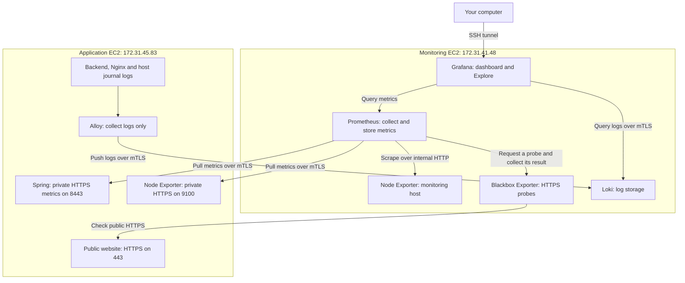
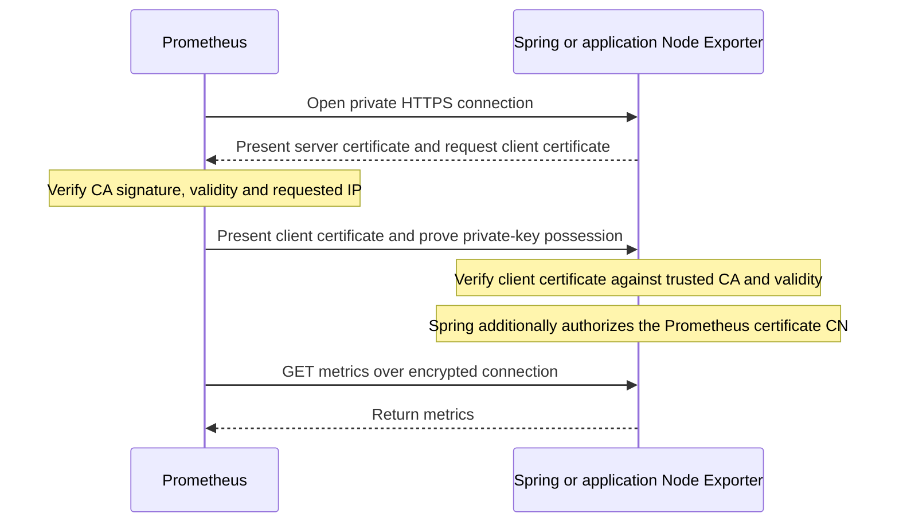
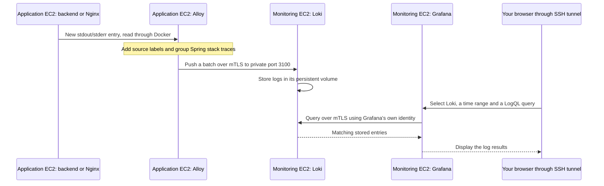

# Understanding and repeating our monitoring setup

This tutorial explains the system we built, why each component exists, and the
order to repeat the setup. It focuses on the decisions and configuration files,
without walking through script internals. The [operational runbook](README.md)
contains the detailed commands; [SYNC.md](../SYNC.md) contains commands using our
actual SSH keys and EC2 addresses.

## 1. What we have achieved

We run monitoring independently of the application, on a dedicated EC2. We have
verified Spring metrics, both hosts' metrics, and the public HTTPS uptime check.
You confirmed `up{job="backend"} = 1` after activating Spring's private listener.

| Capability | Status | How it works |
| --- | --- | --- |
| Host CPU, memory and disk | Working | Node Exporter on each EC2, scraped by Prometheus |
| Spring/JVM and HTTP metrics | Working | Spring exposes metrics privately; Prometheus scrapes over mTLS |
| Public website uptime | Working | Blackbox probes `https://theeverthread.com/` |
| Explore and graph metrics | Working | Grafana queries Prometheus |
| Centralized application/host logs | Working | Alloy ships backend, Nginx and host journal logs to Loki over mTLS |
| Explore logs | Working | Grafana queries Loki using a separate client identity |
| Provisioned application dashboards | Pending | Currently use Grafana Explore to verify metrics |
| Notifications | Not configured | Dashboard-only scope |

HTTP metrics support error-rate and latency analysis. They are not exception
stack traces: use the collected backend logs in Loki to read those details.

## 2. Understand the architecture first



Prometheus initiates collection: this is a **pull** model. Exporters expose
measurements but do not store their history. Prometheus stores the history;
Grafana queries it and renders the results. Grafana does not scrape Spring.

Node Exporter answers “is the machine healthy?” Spring metrics answer “how is
the application behaving?” Blackbox answers “can this monitoring host reach the
public website successfully?” These are different questions: a healthy JVM does
not prove the public HTTPS route works.

The monitoring host can continue running if the application fails. It is still
a single monitoring instance: if that host fails, collection and the dashboard
are unavailable. The public probe represents one observation point, not every
user's experience.

## 3. Know the files and their responsibilities

All links below point to the repository files used for this setup. This is the
current setup snapshot; image tags and IPs should be changed deliberately when
repeating it elsewhere.

| File | What you use it for |
| --- | --- |
| [prepare-host.sh](prepare-host.sh) | Prepare the monitoring Ubuntu host: Docker, Compose and swap |
| [compose.yaml](compose.yaml) | Define Grafana, Prometheus, Blackbox, monitoring-host Node Exporter and optional Loki |
| [init.sh](init.sh) | Create the initial Grafana password and empty log-provisioning placeholder, preserving existing files |
| [prometheus.yml](prometheus.yml) | Define what Prometheus collects, how often, and with which TLS credentials |
| [blackbox.yml](blackbox.yml) | Define the public HTTPS check |
| [loki.yml](loki.yml) | Configure private log storage, mTLS, retention and ingestion limits |
| [verify-loki.py](verify-loki.py) | Verify Loki's TLS protection and synthetic log ingestion/query |
| [alloy.alloy](alloy.alloy) | Select and label log sources, group Spring stack traces, and send to Loki |
| [Loki data-source template](grafana/loki-datasource.json) | Version Grafana's Loki URL and TLS settings without credentials |
| [init-loki-grafana.py](init-loki-grafana.py) | Combine the template with local credentials under ignored `runtime/` |
| [verify-logs.py](verify-logs.py) | Check real log sources through Grafana without printing log contents |
| [Grafana data source](grafana/provisioning/datasources/prometheus.yaml) | Register Prometheus in Grafana automatically |
| [init-mtls.py](init-mtls.py) | Generate and verify our private CA and telemetry identities |
| [app-node.compose.yaml](app-node.compose.yaml) | Run application-host Node Exporter and optional Alloy as a separate Compose project |
| [node-web.yml](node-web.yml) | Require mTLS for application-host Node Exporter |
| [backend.compose.yaml](backend.compose.yaml) | Extend the application's backend service with private metrics configuration |
| [MonitoringConfiguration.java](../../../app/backend/src/main/java/com/theeverthread/foundation/internal/security/MonitoringConfiguration.java) | Add and protect Spring's optional metrics listener |
| [application.yaml](../../../app/backend/src/main/resources/application.yaml) | Make HTTP latency histograms configurable |
| [deploy.sh](../deploy.sh) | Deploy pinned application images and retain the monitoring overlay when enabled |
| [CI workflow](../../../.github/workflows/ci.yml) | Test, build, publish and trigger application deployment |
| [send-deployment.py](../send-deployment.py) | Ask AWS Systems Manager to run the deployment script on EC2 |
| [SYNC.md](../SYNC.md) | Copy tracked configuration from your computer to the correct hosts |

## 4. Separate configuration from runtime state

There are three places to think about:

| Place | Contents |
| --- | --- |
| Git checkout on your computer | Reviewed source, Compose files, service configuration and setup instructions |
| Monitoring EC2: `~/monitoring` | Copied monitoring configuration and local `runtime/` credentials |
| Application EC2 | Application deployment under `/opt/theeverthread`; collectors and telemetry certificates under `~/monitoring` |

Git versions the **instructions and configuration**. It does not contain generated
private keys, certificates, Grafana passwords, or stored metric/log data. Generated
credentials live under ignored `runtime/`; Prometheus, Grafana and Loki data live
in Docker named volumes.

Copying a file, deploying an image, and applying a configuration are separate
operations. A Git commit alone does none of them on EC2. This distinction was
important when Grafana initially showed no backend data: Prometheus still had
the older file, even though the new configuration existed in Git.

## 5. Prepare the host and network

We used Ubuntu 24.04 with approximately **2 GiB RAM and 50 GiB disk**, constrained
by the available free-tier instance. [prepare-host.sh](prepare-host.sh) installed
Docker and Compose and added 2 GiB swap. Swap helps memory spikes; it does not
give the performance or capacity of additional RAM.

The initial budgets are 512 MiB each for Prometheus and Grafana, 96 MiB for each
Node Exporter, and 64 MiB for Blackbox. The opt-in Loki service adds a 512 MiB
limit. Prometheus scrapes every 30 seconds and
retains historical metrics for seven days or approximately 5 GB, whichever limit
is reached first, with additional working-space overhead. Measure usage before
adding logs or increasing retention.

Security groups control which hosts may connect; TLS controls identity and
encryption. Both matter.

| Destination | Inbound rule | Why |
| --- | --- | --- |
| Monitoring EC2 | TCP 22 from your current public IP `/32` | SSH administration and Grafana tunnel |
| Application EC2 | TCP 9100 from the monitoring security group | Application-host metrics |
| Application EC2 | TCP 8443 from the monitoring security group | Spring metrics |
| Public application | Existing TCP 443 access | Public HTTPS and Blackbox check |
| Monitoring EC2 | TCP 3100 from the application security group | Prepared for future Loki ingestion; not active log collection yet |

Use the other instance's security group as the source, not `0.0.0.0/0`, for
private telemetry. A security-group reference permits traffic from qualifying
network interfaces; use the private IPs for these connections.

Our monitoring security group permits outbound traffic. A restricted egress
policy must allow the private scrape ports, public HTTPS checks, and the host's
required DNS, package, registry and management connectivity. Future Alloy traffic
also needs application-host egress to monitoring on 3100. Security groups are
stateful, so response traffic does not need a separate reverse inbound rule.

Do not expose Grafana 3000, Prometheus 9090, or Blackbox 9115 publicly. Grafana
binds to monitoring-host loopback; the other monitoring services have no published
host ports. Blackbox initiates its website check, so it needs no new inbound rule.

## 6. Understand the certificates before generating them

Ordinary HTTPS lets a client verify a server. **Mutual TLS (mTLS)** also lets the
server verify the client. Our Prometheus therefore proves its identity to Spring
and application Node Exporter, while verifying their server identity.

We created our own telemetry certificate authority with
[init-mtls.py](init-mtls.py), on the monitoring EC2. This CA is independent of the
public website's HTTPS certificate. It works because both sides explicitly trust
it; it does not need to match the public website's certificate issuer.

| Item | Meaning | Location |
| --- | --- | --- |
| CA `cert.pem` | Public trust anchor used to verify certificates | Original under monitoring `runtime/pki/ca`; copies as leaf bundles' `ca.pem` |
| CA `key.pem` | Secret authority to sign certificates | Monitoring `runtime/pki/ca` only; never transfer to application or mount into services |
| Application `cert.pem` | Public server identity, valid for private IP `172.31.45.83` | `runtime/pki/app-node` on application; initially generated on monitoring |
| Application `key.pem` | Private proof of that server identity | Same protected bundle; mounted into application Node Exporter and Spring |
| Prometheus `cert.pem` | Public client identity with CN `theeverthread prometheus` | Monitoring `runtime/pki/prometheus` |
| Prometheus `key.pem` | Private proof of that client identity | Monitoring only; mounted into Prometheus |
| Loki server bundle | Proves Loki's private IP and Docker name `loki` | Monitoring `runtime/pki/loki` |
| Alloy client bundle | Lets the application collector authenticate to Loki | Generated on monitoring; securely transferred to application `runtime/pki/alloy` |
| Grafana log-client bundle | Lets Grafana authenticate to Loki | Monitoring `runtime/pki/grafana-loki`; rendered into private runtime provisioning |

The certificate contains the public key and the CA's signature. The matching
private key stays secret: a service uses it to prove possession during TLS, not
by sending it across the connection. The CA certificate alone cannot sign new
certificates.



The application certificate has a server role and an IP SAN matching the private
IP. Prometheus has a client role. We reused the application certificate for Node
Exporter and Spring because both serve the same application-host IP. This reduces
identities to manage but couples their rotation: renew/reload both together.

These certificates are **not used by your browser to view Grafana**. Your
connection travels through SSH, then uses Grafana's own login. Grafana's separate
log-client certificate is used by its server when querying Loki.

## 7. Repeat the setup in dependency order

Our original conversation added services gradually. The current Compose file
already references certificates, so a fresh installation must prepare those
files **before starting the complete stack**.

### A. Prepare and copy configuration

1. Create the monitoring EC2, configure networking, and verify private connectivity
   between hosts.
2. Run the monitoring host preparation script and verify Docker, Compose and swap.
3. From your computer's repository root, use [SYNC.md](../SYNC.md) to copy monitoring
   files and the application-side files to their respective EC2s.

If repeating with new IPs, update `prometheus.yml`, `app-node.compose.yaml`,
`backend.compose.yaml`, the Blackbox target and the sync commands as appropriate.
Generate the server certificate for the **new application private IP**.

### B. Generate credentials on monitoring

On the **monitoring EC2**:

```bash
cd ~/monitoring
bash init.sh
python3 init-mtls.py --app-ip 172.31.45.83

openssl verify -CAfile runtime/pki/ca/cert.pem -purpose sslserver \
  -verify_ip 172.31.45.83 runtime/pki/app-node/cert.pem
openssl verify -CAfile runtime/pki/ca/cert.pem -purpose sslclient \
  runtime/pki/prometheus/cert.pem
```

Both verification commands should return `OK`. They establish purpose, issuer
trust and, for the server, the expected IP. They do not test network connectivity.
Do not repeat generation on your working installation merely to read this tutorial.

### C. Transfer only the application bundle

Copy `runtime/pki/app-node/` from monitoring to a temporary directory on your
computer, then to application EC2 at `~/monitoring/runtime/pki/app-node/`.
Transfer `ca.pem`, `cert.pem`, and `key.pem`; leave the CA signing key and
Prometheus private key on monitoring.

Use authenticated SSH/SCP for this transfer. If using `$bundle_dir`, create it
with `bundle_dir=$(mktemp -d)` and keep both SCP commands in the same local
terminal so the variable remains defined. Remove that temporary bundle after
successful transfer. The [runbook](README.md#step-5b-start-application-node-exporter)
describes the protected directory and credential permissions on application EC2.

### D. Start the monitoring stack and application exporter

On **monitoring**, after the password and certificate files exist:

```bash
cd ~/monitoring
sudo docker compose config --quiet
sudo docker compose up -d --wait --wait-timeout 180
sudo docker compose ps
```

On **application EC2**, after its certificate bundle and collector files exist:

```bash
cd ~/monitoring
sudo docker compose -f app-node.compose.yaml config --quiet
sudo docker compose -f app-node.compose.yaml up -d
```

The collector is a separate Compose project. Always specify
`-f app-node.compose.yaml` on application EC2. The monitoring host instead uses
the default `compose.yaml` in its own `~/monitoring` directory.

Prometheus may initially show Spring as DOWN: its configured endpoint will not
exist until the backend code and overlay are active.

### E. Open Grafana privately

On **your computer**, keep this terminal running:

```bash
ssh -i /Users/samehadel/.ssh/monitoring_ec2_keypair.pem \
  -N -o ExitOnForwardFailure=yes \
  -L 3000:127.0.0.1:3000 ubuntu@3.124.6.143
```

Open `http://localhost:3000`. Log in as `admin`, using the bootstrap password
read on monitoring from `~/monitoring/runtime/grafana_password`. Do not share it.
The provisioned Prometheus data source is already available in Explore.

### F. Deploy the Spring code, then activate its overlay

Our application already used HTTP 8080 internally for normal traffic and health
checks. We added a separate private HTTPS listener on 8443 so telemetry can
require client certificates without changing those existing consumers.

[MonitoringConfiguration.java](../../../app/backend/src/main/java/com/theeverthread/foundation/internal/security/MonitoringConfiguration.java)
creates the optional listener. It requires a trusted client certificate and then
authorizes only the Prometheus identity to GET `/actuator/prometheus`. Other
routes on that listener are denied. Normal HTTP does not expose the metrics.

The [backend overlay](backend.compose.yaml) enables that configuration, mounts
the existing credentials and publishes `172.31.45.83:8443:8443`. Spring must first
be built into a new backend image: copying the overlay cannot add Java code to
an old image.

The release path is:

```text
Merge into main → checks → build/publish pinned images to GHCR
    → GitHub Actions authenticates to AWS
    → send-deployment.py submits an SSM Run Command
    → application EC2 runs /opt/theeverthread/deploy.sh
    → Docker Compose deploys the image references
```

Publishing/deployment requires `AWS_DEPLOY_ENABLED=true` and the configured AWS
role/environment. Merging into `develop` runs checks, not production deployment.
SSM runs the **installed** deploy script; it does not upload Git's latest copy.
That is why we separately synchronized `deploy.sh` and the overlay.

After deploying the new backend image, use the activation block in
[runbook Step 6](README.md#step-6-spring-metrics-on-private-port-8443). It validates
the merged Compose configuration, recreates the backend with the overlay, waits
for health, then creates `/opt/theeverthread/monitoring.enabled`.

That path is an empty **marker file**, not a service or configuration document.
Its presence tells future `deploy.sh` runs to merge the backend overlay with the
base Compose file. Creating it alone does not start the listener. Conversely,
removing it does not immediately change the running container.

Our live frontend had manually configured HTTPS differing from the original
repository base setup. The sync procedure preserves live base Compose and Nginx
files; reconcile such differences deliberately when reproducing or releasing.

### G. Verify the secure endpoint, then load the scrape configuration

On **monitoring EC2**:

```bash
cd ~/monitoring
curl --fail --silent --show-error --connect-timeout 10 --max-time 20 \
  --cacert runtime/pki/prometheus/ca.pem \
  --cert runtime/pki/prometheus/cert.pem \
  --key runtime/pki/prometheus/key.pem \
  https://172.31.45.83:8443/actuator/prometheus \
  -o /tmp/spring-metrics.txt
head -n 15 /tmp/spring-metrics.txt
```

`# HELP`, `# TYPE` and metric values confirm a successful authenticated request.
Also verify that omitting the client certificate fails and that non-metrics
routes on 8443 are denied, as described in the runbook.

Next copy the latest `prometheus.yml` from Git to monitoring using
[SYNC.md](../SYNC.md). Validate and recreate Prometheus:

```bash
cd ~/monitoring
sudo docker compose exec -T prometheus \
  promtool check config /etc/prometheus/prometheus.yml \
  && sudo docker compose up -d --no-deps --force-recreate prometheus
```

Recreation loads the file and its certificate mounts while retaining the data
volume. Wait at least one scrape interval before querying Grafana.

## 8. Read the results correctly

In Grafana Explore, choose Prometheus:

| Query | What success means |
| --- | --- |
| `up{job="prometheus"}` | Prometheus can scrape itself: `1` |
| `up{job="monitoring-server"}` | Monitoring-host exporter scrape succeeds: `1` |
| `up{job="application-server"}` | Application-host exporter scrape over mTLS succeeds: `1` |
| `up{job="backend"}` | Spring scrape over mTLS succeeds: `1` |
| `up{job="public-uptime"}` | Prometheus received a probe report: `1` |
| `probe_success{job="public-uptime"}` | The website passed the actual HTTPS probe: `1` |

`up=1` for a probe does not mean the website is healthy; inspect `probe_success`.
Similarly, a successful Spring metrics scrape does not prove application
readiness: Spring can expose metrics while its readiness endpoint returns 503.
Likewise, container status “Up” only means its process is running, not that a
scrape succeeds.

Try these measurements once collection is working:

```promql
# Application host memory usage, percent
100 * (1 - node_memory_MemAvailable_bytes{job="application-server"}
  / node_memory_MemTotal_bytes{job="application-server"})

# Spring JVM memory, bytes, separated by its metric labels
jvm_memory_used_bytes{job="backend"}

# Application HTTP requests per second
sum(rate(http_server_requests_seconds_count{job="backend"}[5m]))

# Application HTTP 5xx responses per second
sum(rate(http_server_requests_seconds_count{job="backend",status=~"5.."}[5m]))
```

Rate queries need multiple samples and relevant traffic. An absent HTTP series
is not necessarily zero errors; the labeled series may not have been created.
The overlay enables latency histograms for later percentile dashboards, and
Prometheus drops Actuator URI series to reduce monitoring-generated traffic noise.

## 9. Troubleshoot one boundary at a time

| Symptom | First check |
| --- | --- |
| `No data` for `up{job="backend"}` | Is the job in the loaded configuration? Is the selected data source/job name correct? |
| `up=0` | Target exists but scraping failed; inspect connectivity, TLS, endpoint response and Prometheus logs |
| Connection timeout | Private IP, security groups, routing and listener |
| Connection refused | Service/listener running and host port binding |
| Certificate verification failure | Correct CA, current validity, expected IP SAN, certificate purpose and matching key |
| Certificate file not found | Correct host and directory; use `$HOME/monitoring/...` to avoid working-directory ambiguity |
| Spring returns 403 on private metrics | Client certificate identity authorization; trusted CA alone is not sufficient |
| curl works but Grafana has no backend series | Sync `prometheus.yml`, validate it, then recreate Prometheus |

We encountered both path errors and an unsynchronized Prometheus configuration.
Neither required regenerating the CA. Inspect the loaded configuration with:

```bash
cd ~/monitoring
sudo docker compose exec -T prometheus cat /etc/prometheus/prometheus.yml
sudo docker compose logs --tail 50 prometheus
```

## 10. Keep the system repeatable

For configuration changes: **edit Git files → review → sync to the correct host
→ validate → apply/recreate → verify in Grafana**. For Spring code changes, build
and deploy the image too. The pipeline does not manage the monitoring EC2 stack.

Use `sudo docker stats --no-stream`, `free -h`, `df -h /`, and `swapon --show`
to observe resource pressure. Do not use `docker compose down -v` unless you
intend to delete persistent monitoring data.

Leaf certificates last **90 days**, while the CA lasts ten years. Renewal is
currently manual: `init-mtls.py --renew --app-ip 172.31.45.83` renews the leaves
for metrics using the existing CA. With logging enabled, include `--logs` and
follow the additional rotation steps in Section 11. Transfer the new application bundle, then recreate
Prometheus, application Node Exporter and the backend to load replaced files.
Plan renewal before expiry; automatic renewal is still pending. Do not delete
the CA to renew certificates. Back up its signing key securely outside Git.

Changing the private IP requires updating both configuration and the server
certificate's IP SAN. Public-IP changes affect the SSH/sync commands. Changing
the Grafana bootstrap password file does not reset an existing Grafana user's
password stored in its volume.

## 11. Add log collection after metrics

### Each component has a different job

Log collection has two independent connections: **Alloy pushes logs to Loki**,
and **Grafana queries Loki when you search**. Grafana does not connect to Alloy,
read the application server's files, or receive each new entry automatically.

| Component | Where it lives | Responsibility | Related configuration |
| --- | --- | --- | --- |
| Backend and Nginx | Application EC2 containers | Produce application and HTTP access/error messages | Existing application containers |
| Host journal | Application EC2 | Records operating-system and service messages | Existing systemd journal |
| Alloy | Application EC2, collectors project | Read, label and forward log entries | [app-node.compose.yaml](app-node.compose.yaml), [alloy.alloy](alloy.alloy) |
| Loki | Monitoring EC2 | Accept, index, retain and query logs | [compose.yaml](compose.yaml), [loki.yml](loki.yml) |
| Grafana | Monitoring EC2 | Send your LogQL query to Loki and display the response | [Loki data-source template](grafana/loki-datasource.json) |



Host journal entries join the same Alloy-to-Loki path. Prometheus remains the
metrics store: it never receives these log lines. Grafana presents both kinds of
data through separate data sources, so you can investigate a metric spike and
then inspect logs for the same time period.

### Follow one log entry through the system

Suppose Spring logs an exception. Docker captures its stdout/stderr. Alloy
discovers the backend by the stable Compose project and service labels, rather
than a hard-coded container ID. After a release replaces the container, Alloy
discovers its replacement without changing the configuration.

Alloy groups timestamped Spring entries and their following stack-trace lines,
then attaches labels such as `host="application"`,
`job="application-containers"` and `service_name="backend"`. It sends batches to
`https://172.31.41.48:3100/loki/api/v1/push`. Loki stores the message and labels;
the message does not need to contain the labels itself.

Nginx follows the same Docker route because its access and error log files point
to stdout and stderr. Host messages instead come from `/var/log/journal`, with
`job="host-journal"`, `service_name="host-journal"` and a service `unit` label
when available. There is no separate host-log storage service.

Labels identify streams and keep searches manageable. We use a small set of
source labels; request IDs, user IDs and full URLs do not become indexed labels.
Original log text is retained, including URLs and addresses in access logs.

### Understand the two secure connections

Both connections use the existing telemetry CA, but the clients have different
certificates:

| Connection | Server identity | Client identity | Why |
| --- | --- | --- | --- |
| Alloy → Loki | `runtime/pki/loki`, covering `172.31.41.48` | `runtime/pki/alloy`, transferred to application EC2 | Authenticate cross-host ingestion and encrypt logs in transit |
| Grafana → Loki | Same Loki certificate, also covering Docker DNS name `loki` | `runtime/pki/grafana-loki`, kept on monitoring | Authenticate Grafana's queries without sharing Alloy's private key |

Grafana uses `https://loki:3100` on the shared Docker network. Your browser does
not need to resolve that name or reach port 3100: it talks to Grafana through
the existing SSH tunnel and Grafana login. Grafana makes the Loki request on
your behalf. No public Loki or Alloy port was added.

Separate client identities simplify ownership and rotation. They do not create
read-only versus write-only roles: our Loki configuration trusts valid clients
from this CA without that API-level separation.

### How Grafana learns about Loki

The [data-source template](grafana/loki-datasource.json) versions Loki's name,
UID `loki`, internal HTTPS URL and TLS settings. It contains no private key.
[init-loki-grafana.py](init-loki-grafana.py) combines that template with the local
Grafana client bundle to create ignored `runtime/grafana-loki.yaml`.

Compose mounts the generated file into Grafana's provisioning directory. On
startup, Grafana loads it and creates the **Loki** data source. The empty tracked
[target file](grafana/provisioning/datasources/loki.yaml) permits this nested
mount inside the read-only provisioning directory. `init.sh` supplies an empty
runtime placeholder so a metrics-only installation can still start.

This explains why we recreated Grafana after generating the file: it needed to
load the provisioned data source and mount the new file. Restarting Alloy alone
would not register Loki in Grafana. Prometheus remains the default data source.

The generated file contains private credentials. Its parent is protected, it is
excluded from Git, and its contents must not be pasted into the tracked template.

### Repeat the setup in this order

[Runbook Step 7](README.md#step-7-private-loki-log-storage) explains the Loki
storage setup; [Step 8](README.md#step-8-collect-application-logs-and-query-them-in-grafana)
provides the log-collection and Grafana activation commands. The order is:

1. Sync the tracked files to the correct hosts using [SYNC.md](../SYNC.md).
2. On monitoring, generate the additional identities with `init-mtls.py --logs`.
   Without `--renew`, existing CA and metrics credentials are preserved.
3. Validate and start Loki using the monitoring Compose file's `logs` profile.
4. Securely transfer only Alloy's leaf bundle to application EC2.
5. Validate and start Alloy using `app-node.compose.yaml --profile logs`.
6. On monitoring, run `init.sh` and `init-loki-grafana.py`, then recreate Grafana.
7. Run `verify-loki.py` for storage/TLS checks and `verify-logs.py` for real source
   checks through Grafana. Neither prints application log contents or credentials.

Alloy is separate from the application deployment: starting it does not require
rebuilding Spring or restarting backend/frontend. A configuration edit still
needs syncing, validation and collector recreation. Git commits alone do not
update the running collector or Grafana.

### Search and relate logs to metrics in Grafana

1. Open Grafana through your SSH tunnel and log in.
2. Go to **Explore**, select **Loki**, and choose a range such as **Last 15 minutes**.
3. Switch to the code editor if needed, enter one selector, and run it:

```logql
{host="application",service_name="backend"}
```

For Nginx and host messages, respectively:

```logql
{host="application",service_name="frontend"}
```

```logql
{host="application",job="host-journal"}
```

To narrow backend results to error-related text:

```logql
{host="application",service_name="backend"} |~ "(?i)error|exception"
```

The selector chooses streams by labels. The pipeline after `|~` filters their
text with a regular expression; this example is case-insensitive. Expand an
entry to read its full message or grouped stack trace. This is LogQL, not PromQL.

For an investigation, first select **Prometheus** and inspect HTTP error rates
or JVM memory. Note the affected time range, then use Explore's split view or
another tab with **Loki** and the same time range to inspect backend and Nginx
entries. We have not configured automatic metric-to-log links or distributed
tracing; matching the host, service and time range is currently a manual step.

A successful backend scrape (`up=1`) can coexist with readiness `503`. Logs help
explain such failures; the scrape result only confirms metrics can be collected.

### Know what is stored and what can be lost

Alloy has a 192 MiB memory limit and starts with one hour of recent history.
Persistent `alloy_data` stores read positions; it is not the central log archive
and is not a durable outgoing queue. Long outages, exhausted retries, crashes or
source log rotation can lose entries. Its Docker socket access remains powerful
even though the socket is mounted read-only.

Loki has a 512 MiB memory limit and stores logs in persistent `loki_data`, with
three-day asynchronous retention. Restarting Grafana does not delete those logs;
removing Loki's volume does. Retention is not a strict disk-space quota.

Grafana stores users and configuration in `grafana_data`; Loki stores the queried
log history. If Grafana is temporarily unavailable, a running Alloy/Loki path can
continue collecting. If Loki is unavailable, Alloy retries within its configured
limits and cannot guarantee delivery indefinitely.

For renewal with logging enabled, use `--logs --renew`, transfer the renewed Alloy
bundle, regenerate Grafana's private provisioning and recreate all affected
telemetry services. Retain the existing CA. Follow the runbook's complete rotation
procedure because the helper renews metrics identities too.

### Diagnose a missing log source

| Symptom | What to check |
| --- | --- |
| Loki is absent from Grafana's data-source selector | Generated provisioning, correct mounted file, and Grafana recreation |
| Loki data-source connection fails | Loki readiness, Grafana client certificate, trusted CA and `loki` DNS name |
| Backend logs appear but frontend logs do not | Correct service labels, recent Nginx activity and selected time range |
| Host journal logs are absent | Persistent journal path, collector read permissions and recent host activity |
| Alloy reports TLS failures | Correct transferred client bundle, validity and monitoring private-IP SAN |
| Alloy reports 429 or dropped batches | Loki ingestion budget, volume of replayed logs and retry limits |
| Only old entries are missing | One-hour collection window, three-day retention and the selected time range |

Use [verify-logs.py](verify-logs.py) on monitoring to separate a data-source or
collection problem from a mistaken Explore query. A quiet source may need a new
request or harmless journal entry before a recent-time-range check can succeed.

Logs now work end to end. Useful versioned dashboards, certificate-renewal
automation and off-host backup planning remain.
